<div align="center">
  
</div>

<br/>

<div align="center">


</div>

### `>_ cat profile.py`

```python
class Tharindu:
    roles     = ["Entrepreneur", "Founder & CEO", "Full-Stack Engineer"]
    company   = "US-registered software company"
    shipping  = "Production SaaS since 2014"
    reach     = "Customers in 190+ countries · millions of users per month"

    stack = {
        "backend":  ["PHP", "Laravel", "Python", "FastAPI"],
        "frontend": ["Vue", "Inertia", "Next.js", "Tailwind"],
        "data":     ["MySQL", "PostgreSQL", "Redis"],
        "infra":    ["Linux", "Nginx", "Docker", "Cloudflare"],
    }

    def mindset(self):
        return "Zero-trust security. Fast systems. Products that make money."
```

### `>_ ./business --overview`

```diff
+ Founder & CEO of a US-registered software company
+ Took products from zero to millions of monthly users
+ Run product, engineering, operations and payments end to end
+ Global B2C and B2B customer base across 190+ countries
```

### `>_ ls ./expertise`

| Domain | What I do |
|---|---|
| `telecom/` | SMS, voice, number provisioning, HLR lookup, carrier and CPaaS integrations |
| `scale/` | High-traffic apps, query optimisation, caching, queues, database design |
| `security/` | Zero-trust architecture, secure auth, input validation, OWASP Top 10 hardening |
| `payments/` | Subscriptions, top-ups, multi-gateway billing |
| `api/` | REST API design, third-party integrations, white-label reseller platforms |

### `>_ which --all tools`

<p>
  
  <br/>
  
</p>

### `>_ ./connect`

```console
$ echo "Open to partnerships, integrations and business collaborations."
```

<div align="center">
<sub><code>// building reliable software since 2014</code></sub>
</div>
